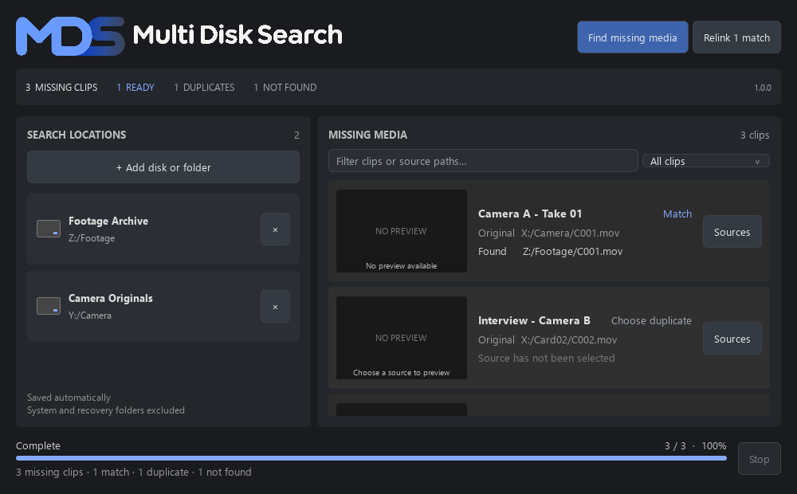

# Multi Disk Search

**Version 1.0.0 · Windows · DaVinci Resolve Studio**

Multi Disk Search finds missing project media across saved disks and folders and relinks it through Resolve's native media-pool API.

## Install

1. Run **MultiDiskSearch-1.0.0-Setup.exe**.
2. Follow the setup wizard, then restart Resolve Studio.
3. Open a project and choose **Workspace > Workflow Integrations > MultiDiskSearch**.

The installer includes the application runtime and adds an entry to Windows Installed apps. No separate Python installation or package downloads are required. The project folder is not needed after installation.

**Requirements:** 64-bit Windows 10/11 and DaVinci Resolve Studio 21.2.

## Use

- Add the media disks or folders to search. Locations are saved automatically.
- Click **Find missing media**.
- Review matches and choose **Sources** when more than one file has the same name.
- Click **Relink matches**, then save the project in Resolve.

The interface includes thumbnails, text and status filters, clip counts and progress indicators. Searches exclude protected system folders and directory links. If a location cannot be searched, a source must be chosen explicitly because additional duplicates may exist there. Failed relink targets remain available for retry.

## Matching and previews

Matching uses the original filename and extension, ignoring case. It does not compare footage contents, duration or timecode. Existing accessible source files are skipped. Image-sequence patterns, renamed footage, spanned packages and advanced synced-media/subclip workflows are not covered by automatic matching.

Previews come from Resolve where available. An optional locally installed FFmpeg can decode previews of found sources. Media stays on your computer.

## Settings and removal

Saved locations: `%APPDATA%\MultiDiskSearch\settings.json`

Startup log: `%APPDATA%\MultiDiskSearch\qt.log`

Uninstall through **Windows Settings > Apps > Installed apps > Multi Disk Search**. Saved locations, Resolve projects and media are preserved.

## Interface

These previews use representative example rows.

[User guide](docs/USER_GUIDE.txt) · [Release notes](docs/RELEASE_NOTES.md) · [Validation](docs/QA_REPORT.md) · [Building from source](docs/BUILD.md)
