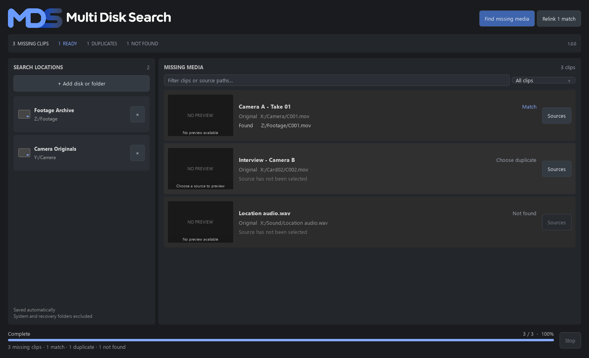

# MultiDiskSearch
**A powerful alternative to DaVinci Resolve's built-in media relinking tool.**

Find and reconnect missing footage across multiple saved drives and folders in one search.

*Interface shown with example media.*

## Go beyond folder-by-folder relinking

Resolve's built-in **Relink Selected Clips** tool only lets you manually search one directory at time. When footage is scattered across separate disks and folders, searching location by location adds manual work. **MultiDiskSearch searches a saved list of locations together**, then puts matches, duplicate candidates and missing files in one review window.

Resolve also offers a deep disk search; see Blackmagic Design's [relinking guide](https://documents.blackmagicdesign.com/UserManuals/DaVinci-Resolve-20-Beginners-Guide.pdf).

## Features

- Parallel searches across independent disks and folders, with automatic worker scheduling.
- A persistent file index with a selectable storage folder, a disk usage readout and automatic refresh while the app is open.
- Index-first search with a disk scan for unmatched filenames.
- Search the entire project or only missing sources used directly on the active timeline.
- Automatic filename matching that skips media already accessible to Resolve.
- Batch relinking through Resolve's native media-pool API, with result checks and retries.
- Duplicate-source selection, thumbnails, path search and status filters.
- Progress indicators, clip counts and a resizable Qt Quick interface.
- Automatic exclusion of protected system folders, recycle bins and directory links.
- In-place updates from GitHub through Settings, with Windows administrator approval.

## Installation

### Requirements

- 64-bit Windows 10 or Windows 11.
- DaVinci Resolve **Studio 21.2** is the supported baseline.
- Connected, readable disks or folders containing the footage you want to find.

### Install

1. [Download the Windows installer](https://github.com/technicallyalex/MultiDiskSearch/releases/download/v1.1.0/MultiDiskSearch-1.1.0-Setup.exe), then run **MultiDiskSearch-1.1.0-Setup.exe**.
2. Follow the setup wizard and approve the Windows administrator prompt when requested.
3. Restart DaVinci Resolve Studio.

The installer includes the runtime and registers the integration. **No separate Python installation or package downloads are required.**

See the [v1.1.0 release](https://github.com/technicallyalex/MultiDiskSearch/releases/tag/v1.1.0) for release notes and the installer SHA-256 checksum. For future releases, use **Settings > Check for updates**.

## Using MultiDiskSearch in Resolve

1. **Open your project** in DaVinci Resolve Studio.
2. **Launch the tool from Resolve's top menu:** **Workspace > Workflow Integrations > MultiDiskSearch**.
3. **Add search locations.** In **Search Locations**, click **+ Add disk or folder** for each media disk or folder. Your choices are saved for future sessions.
4. **Run the search.** Choose a scope and search method, then click **Find missing media**. To inspect or refresh the file index, open **Settings**.
5. **Review the results.** In **Missing Media**, inspect the original and found paths. Use the text and status filters to narrow the list. For duplicate filenames, click **Sources**, select the correct file and click **Use selected source**.
6. **Relink and save.** Click **Relink** on the search toolbar. Check the results, then save your project in Resolve.

Launch through Resolve, rather than the Windows Start menu, to connect the tool to your open project.

## How the file index saves time

The file index is a catalog of filenames and paths in your saved search locations, including subfolders. It stores file details such as size and modification time. Your footage stays on its original drives and takes up no space in the index.

The first index build reads through your folders. After that, MultiDiskSearch can look up missing filenames in the saved catalog instead of walking the same folder trees on every search. This is especially useful if you relink projects often or keep footage on large archive drives or network shares. The source drives still need to be connected for MultiDiskSearch to verify and relink the files.

| Search mode | When to use it |
| --- | --- |
| **File index** | Look up missing filenames in the catalog without scanning the drives. |
| **Index first, then disks** | Use the catalog first, then scan the saved locations for filenames with no usable indexed match. |
| **Drives directly** | Scan the saved locations for every missing filename using the files currently on disk. |

Open **Settings** to choose where the index is stored, see how much disk space it uses, or select **Refresh all**. Automatic updates are on by default while MultiDiskSearch is open. It catches up when you reopen the app or reconnect a drive. MultiDiskSearch checks indexed candidates against the drive. Review those matches through **Sources** before relinking.

## Matching and thumbnails

Matching uses the original **filename and extension**, ignoring case. It does not compare footage contents, duration or timecode. Review sources carefully when cameras reuse filenames.

If a location cannot be searched, source selection becomes manual because that location may contain additional duplicates. Reconnect the disk or correct its access permissions and search again for a complete result.

Current timeline scope includes direct audio and video sources. Nested timeline, compound clip and multicam internals are outside that scope. Relinking a shared Media Pool source affects every timeline that uses it.

Thumbnails come from Resolve where available. An optional locally installed FFmpeg can also generate previews of found sources; FFmpeg is not bundled or required for relinking. Some media may display a placeholder when a preview is unavailable.

Automatic matching does not cover renamed footage, image-sequence patterns, spanned camera packages or advanced synced-media/subclip workflows.

## Troubleshooting and support

- **The integration is missing from Resolve's menu:** finish installation, restart Resolve Studio and check **Workspace > Workflow Integrations**.
- **Footage is not found:** check that the correct disks are connected, the folders are readable and the filenames still match the original media.

Report bugs and request features through [GitHub Issues](https://github.com/technicallyalex/MultiDiskSearch/issues). Include the app version, Windows and Resolve versions, what happened and any relevant error message. Review logs for private paths before sharing them.

| File | Location |
| --- | --- |
| Saved search locations | `%APPDATA%\MultiDiskSearch\settings.json` |
| Startup log | `%APPDATA%\MultiDiskSearch\qt.log` |

## Uninstall

Open **Windows Settings > Apps > Installed apps > MultiDiskSearch > Uninstall**. Saved search locations, Resolve projects and media are preserved.

## Documentation

- [User guide](docs/USER_GUIDE.txt)
- [Release notes](docs/RELEASE_NOTES.md)
- [Validation and compatibility scope](docs/QA_REPORT.md)
- [Building from source](docs/BUILD.md)
- [Third-party components and license notices](packaging/THIRD_PARTY_NOTICES.md)

MultiDiskSearch is an independent application and is not affiliated with or endorsed by Blackmagic Design. DaVinci Resolve is a trademark of Blackmagic Design.
