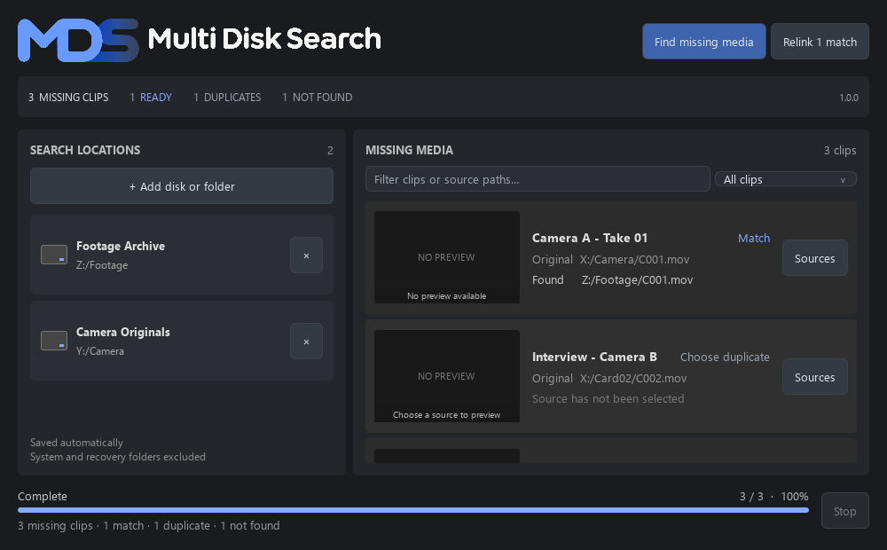

# Multi Disk Search

**v1.0.0 · Windows · Resolve Studio Workflow Integration**

Search saved disks and folders for missing project media, review matches and duplicates, then relink with Resolve's native API. The Qt Quick interface uses the approved rounded blue MDS identity.

## Install

Run in PowerShell from this folder:

```powershell
powershell -NoProfile -ExecutionPolicy Bypass -File .\Install.ps1
```

The installer registers **Workspace > Workflow Integrations > MultiDiskSearch**, removes this application's obsolete Scripts-menu launchers, and preserves saved locations. Restart Resolve to refresh its menus. Keep this application folder in place; the installed launcher points to it. Installing into ProgramData requires write permission there.

Requires Windows, Python 3.10+ and Resolve Studio scripting support. The private .venv contains the Qt runtime; first-time setup downloads PySide6. Version 1 is distributed as source with an installer script, not a self-contained executable. External scripting does not need to be enabled. See the QA report for verified coverage and remaining limitations.

## Use

1. Open a project and launch MultiDiskSearch from Workflow Integrations.
2. Add media disks or folders. Their names and paths are saved automatically.
3. Choose **Find missing media**. Protected system/recovery/recycle folders and directory links are excluded.
4. Review results using the text and status filters. Counters summarize the entire scan.
5. Choose **Sources** to resolve duplicate or incomplete-search results. Any search error prevents automatic target selection because additional duplicates might be hidden on an unreadable disk.
6. Choose **Relink matches**, then save the project in Resolve. Failed targets remain available for retry.

Matching uses filename and extension, ignoring case. It does not compare media content, duration or timecode. Accessible source files are skipped. Image-sequence patterns, renamed media, spanned packages and advanced subclip/synced-media cases need additional validation.

Previews use optional local FFmpeg and Resolve's frame export API, with placeholders when unavailable. Footage stays local. Progress reports folder/clip counts once totals are known; discovery shows activity without an invented percentage. Stop finishes the current folder or clip operation. A stopped search cannot provide automatic matches.

## Project layout

| Location | Contents |
| --- | --- |
| Root Python/QML files | Current application and launcher |
| assets/brand/ | Transparent SVG mark, wordmark and window icon |
| .venv/ | Required private runtime; do not delete while using the application |
| tests/ | Automated regression and UI checks |
| tools/ | Preview builder and opt-in disposable Resolve test |
| docs/ | Current QA report, historical QA, plugin plan, release notes and retained UI preview |
| design/branding/ | Preserved logo explorations and generation prompts; not installed or packaged |
| dist/ | Current source package and SHA-256 checksum |

Settings: `%APPDATA%\MultiDiskSearch\settings.json`. Startup diagnostics: `%APPDATA%\MultiDiskSearch\qt.log`. These are outside the project and survive updates/uninstall.

## Development and QA

```powershell
.\.venv\Scripts\python.exe -B -m unittest -v
powershell -NoProfile -ExecutionPolicy Bypass -File .\tools\Build-Preview.ps1
```

Tests run from the project root and generate disposable outputs under qa-artifacts/. The preview ZIP excludes runtime, tests, test media, design explorations and SDK binaries. Its installer still needs Python and a first-time dependency download.

[Current QA](docs/QA_REPORT.md) · [Plugin plan](docs/PLUGIN_PLAN.md) · [Release notes](docs/RELEASE_NOTES.md)

Run `Uninstall.ps1` to remove the Workflow Integration launcher. It checks installation ownership and preserves saved settings, application files and media. The optional `-Target Scripts` switch exists only for removing legacy launchers.

## UI previews

These are offscreen renders of the v1 interface with representative test rows, not completed live search-and-relink screenshots. The mark and wordmark are transparent SVG outlines traced from the approved mockup, with the shadow-S gradient. Live capture was interrupted with Escape and remains pending.



